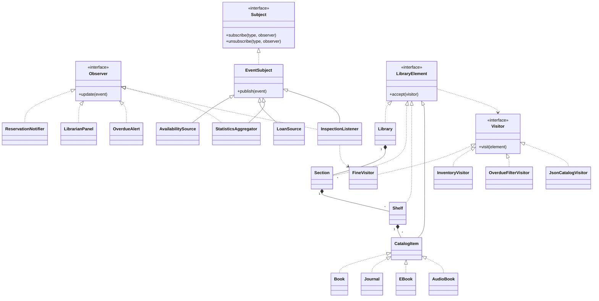

# Assignment 6 - Library

## Topic

Variant 18 - Library

Java 17, Observer Pattern, Visitor Pattern, JUnit 5.

## Observer Pattern

The system has two event sources:

- AvailabilitySource
- LoanSource

Five listeners:

- ReservationNotifier
- LibrarianPanel
- OverdueAlert
- StatisticsAggregator
- InspectionListener

Generic Subject and Observer interfaces are used.

Events are immutable records with an event type.

Listeners subscribe to specific event types. They can subscribe and unsubscribe at runtime, including inside their own handlers.

Push notification is used because event data is passed directly to listeners.

StatisticsAggregator collects events and publishes new statistics events.

## Visitor Pattern

The library uses a Composite tree:

Library -> Section -> Shelf -> CatalogItem

Container types:

- Library
- Section
- Shelf

Leaf types:

- Book
- Journal
- EBook
- AudioBook

Four visitors:

- FineVisitor - calculates total fines
- InventoryVisitor - accumulates inventory statistics
- OverdueFilterVisitor - returns overdue items
- JsonCatalogVisitor - exports the catalog to nested JSON

Visitors control tree traversal.

Double dispatch is implemented through accept() and visit().

Element classes contain data and accept() methods.

## Integration

1. AvailabilitySource publishes an AVAILABLE event.
2. InspectionListener receives the event.
3. FineVisitor calculates fines for the related Shelf only.
4. InspectionListener publishes an INSPECTION event.
5. LibrarianPanel receives the inspection result.

## Concurrency

LibrarySimulation uses ExecutorService with a configurable number of producer threads.

The minimum number of producer threads is 3.

Thread safety is provided by:

- ConcurrentHashMap for event subscriptions
- CopyOnWriteArrayList for listener lists
- AtomicInteger for shared counters
- Immutable event records

The simulation waits for producer tasks to finish and shuts down the executor.

## Clean Code

Main is the composition root.

Dependencies are provided through constructors.

Business classes do not use lazy initialization.

Classes have separate responsibilities and depend on interfaces where appropriate.

No java.util.Observable or external event-bus libraries are used.

## UML Class Diagram



## Visitor Trade-off

### Adding a new Visitor

Commit: Add overdue filter visitor without changing elements

Changed files:

- Visitors.java
- Main.java
- LibraryTest.java

LibraryTree.java was not modified.

A new operation can be added without changing existing element classes.

### Adding a new element type

Commit: Add audiobook element and update visitors

Changed files:

- LibraryTree.java
- Visitors.java
- Main.java
- LibraryTest.java

Adding AudioBook required updating the Visitor interface and all concrete visitors.

Visitor is useful when operations change frequently but the element structure remains stable.

If new element types are added frequently, Visitor becomes more expensive to maintain.

## Tests

17 JUnit 5 tests cover:

- Fine calculations
- Inventory statistics
- JSON export and escaping
- Event subscriptions
- Dynamic subscribe and unsubscribe
- Observer aggregation
- Observer and Visitor integration
- Overdue filtering
- AudioBook operations
- Concurrent event processing

Stress test: 4 producer threads x 1,000 events.

Expected result: exactly 4,000 events.

Run tests:

```bash
mvn test
```

## Run

Run library.Main in IntelliJ IDEA.

Default configuration:

- 3 producer threads
- 10 events per producer

Optional program arguments:

```text
4 1000
```
